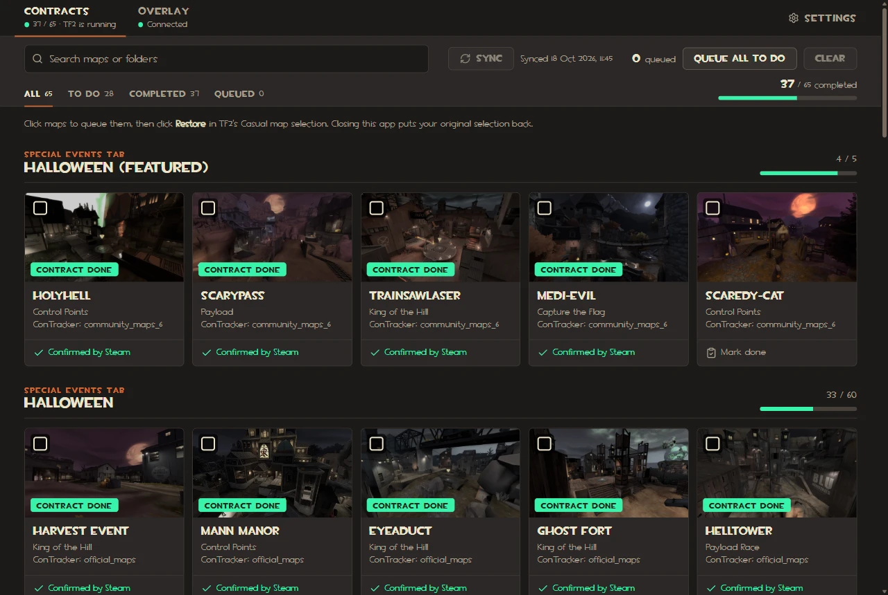

#  TF2 Halloween Utils

A Windows app for Team Fortress 2's Scream Fortress:

- **Contracts**: a checklist of the Halloween map contracts. It syncs your progress from Steam, follows your matches, and queues the maps you still need.
- **Overlay**: in-game widgets, each with its own switch: a radar that points to your soul gargoyle, and a countdown to the end of the contracts.

## Download

Get `tf2-halloween-utils.exe` from the [latest release](https://github.com/Rhgx/tf2-halloween-utils/releases/latest) and run it. There is nothing to install. The exe is not signed, so SmartScreen asks first: click **More info**, then **Run anyway**.

It needs 64-bit Windows and TF2 from Steam. On Linux, use [1.2.1](https://github.com/Rhgx/tf2-halloween-utils/releases/tag/v1.2.1) for now.

## Docs

- [Contracts](docs/using/contracts.md): signing in, queueing maps, following your matches
- [Overlay](docs/using/overlay.md): the widgets, moving them, hotkeys; [the radar's setup](docs/using/radar.md)
- [Settings and data](docs/using/settings.md)
- [Everything else](docs/README.md): how it works, development, credits

## License

[MIT](LICENSE). Map screenshots and fonts are Valve's; see [credits](docs/credits.md).
