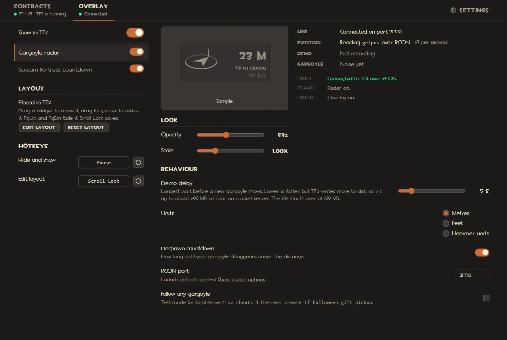

# Overlay

Widgets drawn over TF2: the **Gargoyle radar** and the **Scream Fortress countdown**. Clicks pass through them to the game. They need TF2 in **Windowed (no border)** mode. Nothing in the game files changes and TF2's memory is not read; [how the overlay works](../how-it-works/overlay.md) explains what it does instead.

## The Overlay tab

On the left: **Show in TF2**, the switch for everything, then the widget list with a switch per widget, and under it what the widgets share: the in-game layout (**Edit layout**, **Reset layout**) and the hotkeys. Selecting a widget shows its preview, its **Opacity** and **Scale**, its status and its settings on the right. Where a widget sits is set in game, in edit mode.

## Gargoyle radar

Points to your soul gargoyle: direction, distance, height and how long until it despawns. It needs launch options once; see [the radar's page](radar.md) for the setup, its settings and what to do if it does not connect.

## Scream Fortress countdown

How long until this year's contracts end, orange on the last day. The date comes from TF2's own files, so it follows Valve when the event is extended. It needs no launch options.

**Format** picks how the time left is written; each choice shows its text for right now:

- **Adaptive**: days, then days and hours in the last three days, hours and minutes on the last day, a clock in the last hour.
- **Days**: "In 20 days", "In 1 day", "Today".
- **Detailed**: "20 d 14 h 05 m".
- **Clock**: "20:14:05:09".

## Moving the widgets

**Edit layout**, or the edit hotkey in game, starts edit mode for every widget. Press Esc in TF2 to free the mouse, then drag a widget; widgets snap to the screen edges and to each other. Dragging a widget's corner, or `+` and `-`, resizes it; PgUp and PgDn fade it; the arrow keys nudge it (Shift for 10 px). These act on the widget you grabbed last. Home resets, and the edit hotkey saves. **Reset layout** in the app puts every widget's position, opacity and scale back.

## Hotkeys

- **F3**: hides and shows the overlay.
- **F4**: starts edit mode, and saves it.

TF2 leaves both unbound, and every keyboard layout names them the same way. On a 60% keyboard they are Fn+3 and Fn+4. In edit mode the arrow keys, PgUp, PgDn and Home need Fn there too; the mouse moves and resizes without them, and each widget's Opacity is also in the app.

To change them, click a key field under Hotkeys in the Overlay tab and press a key or Mouse 4/5. Esc cancels. The keys edit mode uses cannot be hotkeys.
